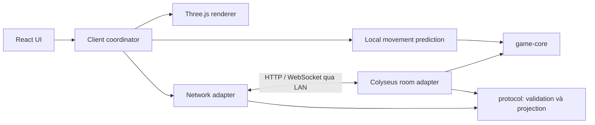
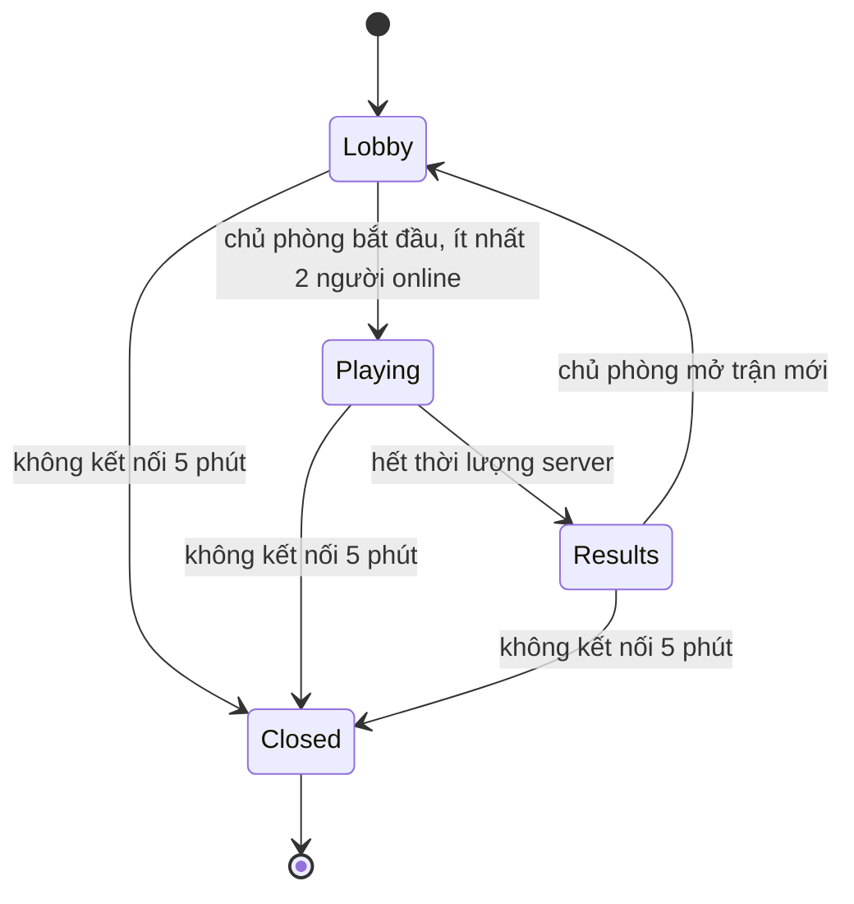

# Đặc tả kỹ thuật — Game văn phòng tranh món ăn

Ngày chốt: 2026-11-06. Trạng thái: thiết kế đã được người dùng xác nhận qua Q1–Q33; chưa có mã nguồn hoặc bằng chứng chạy game.

## 1. Phạm vi và thẩm quyền tài liệu

- [game-spec.md](./game-spec.md): luật sản phẩm và trải nghiệm đã chốt.
- Tài liệu này: kiến trúc, ranh giới, mô hình dữ liệu và cấu hình kỹ thuật.
- [network-protocol.md](./network-protocol.md): hợp đồng kết nối, input, đồng bộ và lỗi.
- [validation-plan.md](./validation-plan.md): cách chứng minh chức năng, hình ảnh và hiệu năng.
- [implementation-plan.md](./implementation-plan.md): thứ tự triển khai và điều kiện hoàn thành từng mốc.
- [GLOSSARY.md](../GLOSSARY.md): thuật ngữ miền nghiệp vụ.

Q33 cho phép tự chốt chi tiết kỹ thuật trong ràng buộc đã duyệt. Thông số được ghi là cấu hình chơi thử có thể điều chỉnh sau đo; thay đổi luật, phạm vi hoặc mục tiêu phải được nêu rõ để người dùng quyết định. Không có nhánh thiết kế nào đang chờ câu trả lời; các bước đo, chọn asset cụ thể và duyệt mẫu là công việc kiểm chứng khi triển khai.

## 2. Mục tiêu và giới hạn

| Nội dung | Quyết định |
| --- | --- |
| Triển khai đầu tiên | Một máy local chạy server độc lập; đồng nghiệp dùng trình duyệt qua LAN công ty |
| Tải mục tiêu | 10 phòng × tối đa 8 chỗ, tổng tối đa 80 người; cần đo trên máy host |
| Thiết bị client | Laptop văn phòng có GPU tích hợp, 1366×768; Chrome/Edge desktop có WebGL2 |
| Hình ảnh | Hướng tới 60 FPS; tối thiểu 30 FPS ở chế độ thấp với phòng 8 người |
| Mạng | Chơi ổn ở RTT khoảng 100 ms; kiểm thử thêm 200 ms và mạng chập chờn |
| Lưu trận | RAM, không database; server restart làm mất phòng/trận |
| Reconnect | Giữ người, điểm, máu, hình phạt khi server còn chạy |
| Internet lúc chơi | Không cần sau khi cài đặt/build; mọi asset, font và decoder phục vụ local |
| Ngoài phạm vi | Tài khoản, đặt đồ ăn, điều khiển điện thoại, khôi phục trận sau crash, hosting public |

Máy host và máy client tham chiếu được ghi cấu hình trong báo cáo đo. Sức chứa và FPS là mục tiêu, chưa phải kết quả đã đạt. Khả năng máy công ty truy cập nhau qua LAN cần kiểm chứng thực tế.

## 3. Stack và chính sách phiên bản

| Phần | Công nghệ |
| --- | --- |
| Ngôn ngữ | TypeScript strict, ES modules |
| Runtime server | Node.js 24 LTS làm baseline; npm đi cùng runtime |
| Client | Vite, React + CSS cho giao diện, Three.js trực tiếp cho cảnh |
| Multiplayer | Colyseus 0.18 làm baseline, WebSocket, một tiến trình |
| Workspace | npm workspaces, một package-lock.json ở root |
| Chất lượng | ESLint, Prettier, Vitest, Playwright |
| Asset | GLB, animation clip; tài nguyên nằm trong bản build local |

Node 24 là baseline LTS được hỗ trợ. Tại mốc nền tảng, chọn các bản stable tương thích, kiểm tra engines/peer dependencies, khóa phiên bản chính xác trong manifest/lockfile và runtime pin. Không cài dependency hoặc tạo lockfile trong nhiệm vụ thiết kế này. Không dùng prerelease hoặc ép bỏ kiểm tra peer dependency để vượt bước kiểm chứng. Nếu Colyseus 0.18 không vượt được kiểm thử tích hợp, báo bằng chứng và cập nhật baseline kỹ thuật, giữ các luật đã chốt.

Cơ sở: [Node releases](https://nodejs.org/en/about/previous-releases), [Vite requirements](https://vite.dev/guide/), [Colyseus input/fixed timestep](https://docs.colyseus.io/netcode/server-input), [prediction](https://docs.colyseus.io/netcode/client-prediction). Đây là cơ sở khả năng framework, không thay thế thử nghiệm project thực tế.

## 4. Kiến trúc và cấu trúc project



```text
apps/
  client/src/
    app/                # màn hình, routing, UI state
    game/               # vòng lặp, input, camera, animation, audio
    network/            # transport, snapshot, reconnect, prediction adapter
  server/src/
    rooms/              # phase, session, capacity, chủ phòng
    simulation/         # clock, input scheduling, adapter game-core
    http/               # static files, health, tạo/join phòng
packages/
  game-core/src/
    model/              # dữ liệu gameplay thuần
    systems/            # movement, combat, NPC, item, respawn
    rules/              # scoring, ranking, validation cấu hình trận
    maps/               # office map definition
    config/             # thông số cân bằng
  protocol/src/         # DTO, runtime validation, schema Colyseus, lỗi
assets/                 # nguồn asset; manifest quy định đường dẫn output
  ATTRIBUTION.md        # tạo khi chọn asset đầu tiên
docs/
```

`game-core` không import React, Three.js, Colyseus, DOM hoặc socket. `protocol` được phép tham chiếu kiểu dữ liệu thuần của `game-core`; `game-core` không import ngược. Client có thể import phần movement và map từ core; server giữ toàn bộ quyết định gameplay. Không đưa bí mật server vào package dùng chung. Xem [ADR 0002](./adr/0002-game-core-boundary.md).

Các seam dự kiến, là hợp đồng thiết kế chứ chưa phải API đã hiện thực:

| Interface | Trách nhiệm |
| --- | --- |
| createMatch(config, roster, map, seed, nowMs) | Tạo trạng thái trận mới; roster/config được chụp và khóa |
| stepMatch(state, inputs, fixedDt, nowMs) | Tiến một tick, trả state và domain events theo thứ tự |
| stepMovement(body, intent, map, fixedDt) | Cùng luật di chuyển/va chạm cho server và prediction |
| rankPairs(scores) / finalizeMatch(state) | Một comparator dùng cho HUD và kết quả |
| projectPublicState(state) | Chuyển mô hình nội bộ sang schema truyền mạng, không lộ khóa |
| applySnapshot(snapshot) | Cập nhật client store, reconciliation và UI projection |
| disposeMatch() / disposeClientGame() | Hủy timer, listener, input queue và tài nguyên tương ứng |

React dùng store/projection cho HUD; renderer đọc trạng thái game trong requestAnimationFrame. Không cập nhật React state cho từng vị trí mỗi frame. Chỉ có một vòng lặp renderer và một bộ đăng ký input cho mỗi client game instance.

## 5. Dữ liệu và quyền sở hữu

| Đối tượng | Dữ liệu chính |
| --- | --- |
| Room | roomId, mã mời, phase, hostPlayerId, joinOrderCounter, member/seat records, emptyDeadline |
| Member | playerId, joinedOrder ban đầu, tên/ngoại hình, connectionGeneration, connected, outsideMatchSeatDeadline |
| Match | matchId, configSnapshot, mapVersion, rosterSnapshot, tick, start/end deadline, nextEventSeq, result |
| Participant | playerId, matchJoinOrder, vị trí/hướng, HP, velocity/knockback, respawn/protection/cooldown deadlines |
| Food score | playerId + foodId → count, reachedEventSeq của lần tăng gần nhất |
| Item | itemId, foodId, position, announcedAt, landedAt, expiresAt, phase |
| NPC | npcId, position, AI state, targetId, lockedAttackDirection, state deadline, path |
| Result | resultId, matchId, winner pair hoặc null, bảng kết quả đóng băng |

Room/session là sở hữu của server adapter; dữ liệu gameplay là sở hữu của core. Public state không có reconnect secret, random seed phục vụ server hoặc hàng đợi input người khác. Client không có quyền sửa số điểm/HP/vị trí chính thức.

Định danh người chơi độc lập connection/session ID của framework. Các ID và epoch theo trận bảo đảm message/animation từ trận cũ không tác động trận mới. Đổi tên không tạo người mới. Mọi score row của người đã rời được giữ đến khi chốt kết quả.

## 6. Vòng đời phòng và người chơi



- Tối đa 8 chỗ; trong trận giữ toàn bộ chỗ roster ban đầu kể cả rời/mất mạng. Người mới chỉ vào chờ nếu còn chỗ.
- Ngoài trận: mất mạng giữ chỗ 60 giây, rời chủ động giải phóng ngay. Record định danh còn tới khi phòng đóng nhưng record không có chỗ không bảo đảm quyền vào lại khi phòng đầy.
- Bắt đầu trận chụp tất cả người online, ít nhất 2 và tối đa 8; người offline không giữ chỗ qua trận mới, quay lại là người chờ nếu còn chỗ. Việc bắt đầu và join được serialize trong room adapter.
- Trận kết thúc: chỗ offline được chuyển sang grace 60 giây từ lúc kết thúc; người đã rời chủ động không giữ chỗ ngoài trận. Result là bản sao bất biến, không phụ thuộc việc dọn member records.
- Host là người online có joinedOrder ban đầu nhỏ nhất. Nếu tất cả offline, hostPlayerId = null; người đầu tiên quay lại được chọn, không ưu tiên chủ cũ. Không tự chuyển quyền ngược khi người cũ quay lại.
- Không có kết nối 5 phút thì đóng phòng kể cả trận chưa hết giờ. Có kết nối trở lại thì hủy empty deadline. Đặt Colyseus autoDispose=false và quản lý timeout đóng phòng riêng; maxClients=8 cùng bộ đếm chỗ của ứng dụng. Không lấy riêng clients.length làm sức chứa vì còn reserved seat và roster offline.
- Reconnect secret riêng từng room được lưu localStorage theo origin; không đưa vào URL/log/public schema. Chuyển IP/port hoặc dùng profile/ẩn danh khác là origin/storage khác và không được bảo đảm nhận lại người cũ.
- Kết nối mới hợp lệ tăng connectionGeneration, thay tab cũ; callback đóng của tab cũ không được đánh dấu tab mới offline. Tab bị thay dừng retry tự động, hiện thông báo.
- Rời chủ động trong trận: dừng điều khiển, avatar giữ tại chỗ như mất kết nối; vẫn chịu tác động, giữ điểm và chỗ. Cùng khóa quay lại được khôi phục trong trận đó.
- Về sảnh tạo vòng đời trận mới: bỏ entity, score, input, timer và event cũ; giữ roomId, member identity, tên/ngoại hình và thứ tự vào phòng. Config trở lại trạng thái chỉnh sửa; không tự bắt đầu.

Chuyển trạng thái thành kết quả và công nhận người thắng luôn do server, không có lệnh host kết thúc sớm. Giới hạn phục hồi: [ADR 0001](./adr/0001-no-match-recovery.md).

## 7. Clock, tick và tính thứ tự

Dùng đồng hồ monotonic phía server, truyền nowMs vào core thay vì core tự đọc thời gian hệ thống. Snapshot gửi serverTimeMs trong cùng miền thời gian cùng deadline; client ước lượng offset cho HUD, không tự chốt hết trận. Date/time hệ điều hành không dùng để phân xử gameplay.

Khởi điểm mô phỏng 30 Hz và patch 20 Hz, render độc lập. Fixed dt = 1/30 giây; không nhận dt từ client. Khi server trễ, xử lý tối đa 5 bước catch-up rồi ghi nhận overload; không tăng vận tốc theo số gói input hoặc tạo vòng catch-up vô hạn. Deadline thời gian thực vẫn được kiểm tra trước gameplay để server quá tải không kéo dài trận. Không tái sử dụng input đã quá 250 ms cho catch-up.

Thứ tự tick:

1. Nếu nowMs >= endAt: finalize một lần, hủy spawn/item/attack còn chờ, không chạy các pha sau.
2. Hết hạn item, hồi sinh, kết thúc bảo vệ và các deadline. Nếu một đợt đến lịch, tạo warning; các item tới landedAt chuyển sang nhặt được trước pha di chuyển.
3. Di chuyển, AI/path steering và knockback đang tồn tại, xử lý vật cản.
4. Thu thập các đòn hợp lệ từ trạng thái đầu pha chiến đấu; việc chủ động đánh bỏ bảo vệ trước khi kiểm tra miễn sát thương. Tính tất cả hit trước khi áp dụng damage và knockback, cho phép cùng hạ nhau. Người về 0 HP vào bất động ngay.
5. Nhặt các item đã chạm đất, chưa hết hạn bằng người thuộc roster và không bất động. Bảo vệ không cấm nhặt.

Mất input hoặc mất kết nối chỉ dừng điều khiển, không xóa avatar khỏi kiểm tra gameplay: vẫn bị đánh, chạy deadline và có thể nhặt nếu item chạm avatar còn đủ điều kiện. Không thêm cơ chế miễn sát thương hoặc xóa hình phạt cho người offline.

Duyệt item theo itemId có thứ tự tạo tăng dần. Với từng item, chọn ứng viên gần tâm nhất; bằng khoảng cách dùng matchJoinOrder. Cấp eventSeq sau mỗi lượt nhặt được công nhận. Đây là quy ước deterministic, có lợi thế thứ tự vào trận khi khoảng cách bằng tuyệt đối; không tuyên bố bốc thăm công bằng. Item chỉ được tiêu thụ một lần.

Comparator: count giảm dần, reachedEventSeq tăng dần. Xét mọi cặp có count > 0; cặp tốt nhất của mỗi người dùng cho HUD. Không có cặp nào thì winner = null. Result lưu tên/ngoại hình của trận, không đổi theo lần chỉnh sửa sau.

## 8. Mô phỏng và cấu hình chơi thử

1 đơn vị = 1 m. Trường `BalanceConfig` tập trung trong game-core; server khóa configSnapshot khi bắt đầu trận. Chỉ đổi cấu hình giữa các trận, chưa có màn hình host chỉnh sức mạnh.

| Thông số | Khởi điểm | Nguồn quyết định |
| --- | --- | --- |
| Văn phòng | Khoảng 24 × 18 m, một tầng | Q28 |
| Tốc độ người chơi / bán kính | 4 m/s / 0,35 m | Q28 |
| HP / sát thương người chơi | 100 / 20 | Spec sản phẩm |
| Cooldown người chơi | 0,6 s giữa hai lần ra đòn | Spec sản phẩm |
| Tầm / góc đánh người chơi | 1,4 m từ tâm / 90° tổng góc | Q28 |
| Đẩy lùi | 0,5 m trong 0,15 s, dừng ở vật cản | Q28 |
| Bất động / bảo vệ | 8 s / 3 s | Spec sản phẩm |
| Tốc độ / phát hiện / bỏ đuổi NPC | 3 m/s / 6 m / 9 m | Q28 |
| NPC damage / khoảng cách hai lần gây đòn | 7 / tối thiểu 1 s | Spec sản phẩm |
| NPC báo đòn | 0,5 s, hướng khóa | Q28 |
| NPC tầm / góc đánh | 1,4 m / 90° | Mặc định Q33 |
| Số NPC | 1 với roster 2–4, 2 với 5–8 | Q20 |
| Mong muốn hồi sinh | Cách nhân vật khác ít nhất 3 m | Q28 |
| Nhặt item | Tâm cách tối đa 0,6 m, không xuyên vật cản | Mặc định Q33 |
| Spawn | ceil(rosterSize / 2) item mỗi 3 s | Q20, Q29 |
| Warning / thời gian tồn tại | 1,5 s / 15 s sau chạm đất | Q29 |

Chuẩn hóa vector chạy để không tăng tốc chéo. Chuột chiếu xuống sàn xác định hướng nhìn; không cập nhật hướng khi con trỏ nằm trên UI hoặc không chiếu hợp lệ. Giữ hướng hợp lệ gần nhất. Chỉ click mới yêu cầu đánh, không tự đánh liên tục khi giữ chuột; cooldown được kiểm tra server. Chọn mục tiêu gần nhất trong vùng trước mặt và có đường đánh không xuyên vật cản; gồm người chơi đủ điều kiện và NPC, cùng khoảng cách phân xử theo ID ổn định. NPC bất tử nhưng nhận đẩy lùi; không có stun mới ngoài bất động đã chốt.

Hình tròn va với các hình chữ nhật theo XZ, dùng swept collision hoặc chia bước để không xuyên vật cản ở đẩy lùi; hỗ trợ trượt dọc cạnh. Nhân vật/NPC không chặn nhau. Model nội thất và collider cùng được sinh/định vị từ một map definition; tránh collider của ghế nằm lệch asset hoặc đường đi hình ảnh rộng nhưng collider bị bít.

Lưới A* khởi điểm cell 0,5 m, đánh dấu vật cản sau khi nới theo bán kính nhân vật. Trước phát hành kiểm tra mọi điểm hồi sinh, patrol và item có đường đi trong vùng liên thông. Repath NPC tối đa 4 Hz, chia lịch giữa NPC; nếu không có đường thì về tuần tra ở điểm hợp lệ, không teleport qua bàn. Khi mất mục tiêu bất động/bảo vệ thì hủy đuổi; đã vào windup giữ hướng, kiểm tra đối tượng hợp lệ tại thời điểm hit. Đẩy lùi không xóa cooldown hoặc tự tạo thêm đòn.

Hồi sinh chọn điểm ngoài vật cản có khoảng cách tối thiểu tới NPC/người chơi khác lớn nhất; bỏ qua vị trí cũ của chính người hồi sinh. Khi cùng điểm số dùng thứ tự spawnPointId. Không có điểm đạt 3 m vẫn dùng điểm tốt nhất đúng hạn 8 giây.

Warning đầu ở startAt; các đợt tiếp theo startAt + n×3 s. LandedAt = warningAt + 1,5 s; expiresAt = landedAt + 15 s. FoodId được chọn độc lập, xác suất ngang nhau. Vị trí nằm trong vùng đi tới được, có khoảng trống cho collider người chơi; không đặt tâm trong vật cản hoặc sát vật cản đến mức không thể nhặt. Dùng RNG có seed ở server để có thể tái hiện test; client không quyết định seed. Nếu quá tải bỏ các đợt spawn đã quá lịch thay vì dồn toàn bộ lượng rơi vào một tick; ghi số đợt bỏ để báo test tải.

## 9. Hình ảnh, nội dung và tài nguyên

Ảnh tham chiếu: [character-style.png](./references/character-style.png). Định hướng là chibi low-poly có tạo dáng và silhouette dễ nhận diện; không lấy chữ hoặc con số polygon trong ảnh thành yêu cầu kỹ thuật.

- Một văn phòng; bộ nhân vật chung, 8 màu trang phục, 3 kiểu tóc, 3 lựa chọn phụ kiện gồm không phụ kiện. Ngoại hình không thay đổi collider hoặc chỉ số.
- Model GLB, animation đứng/chạy/đánh/bất động/hồi sinh. Rig và animation tương thích, có thể dùng chung clip; mỗi nhân vật có trạng thái animation độc lập.
- Ưu tiên asset miễn phí được phép dùng, ghi nguồn, license và sửa đổi khi chọn. Không có asset cụ thể nào đã được chọn hoặc duyệt trong nhiệm vụ thiết kế này.
- Duyệt một mẫu nhân vật và một góc văn phòng ở camera/kích thước gameplay, thử chạy và đánh trước khi nhân rộng. Asset không đạt mẫu không được coi là hoàn thành hình ảnh.
- Camera theo người chơi, góc nghiêng cố định, không xoay trong bản đầu; người chờ đổi đối tượng theo dõi. Khi không có đối tượng phù hợp dùng góc nhìn toàn văn phòng, không để camera lỗi.
- Nội thất che nhân vật cục bộ mờ đi ở lớp rendering; collider không đổi. Nhân vật có tên, màu và dấu nhận diện bản thân. Người chờ không có entity riêng.
- Món mẫu dùng model/biểu tượng từ manifest; món tự nhập dùng model chung kèm biểu tượng và tên. Không tạo model riêng theo chuỗi tên món.
- Mute lưu ở trình duyệt; kích hoạt audio sau tương tác người dùng. Dedupe SFX theo event ID, không phát lại SFX cũ khi reconnect.

Ngân sách ban đầu theo Q33, được điều chỉnh khi đo và phải giữ mức hình ảnh đã duyệt: tối đa khoảng 5.000 triangle cho một nhân vật, tổng cảnh đang thấy khoảng 250.000 triangle, 150 draw call, texture atlas 1024² hoặc nhỏ hơn khi đủ. Tài nguyên bắt buộc cho một phòng mục tiêu <= 25 MB khi truyền. Đây là budget phát triển, không phải phép thay thế FPS hoặc lý do giảm chất lượng mẫu mà không nêu rõ.

Chế độ thấp giảm pixel ratio xuống tối đa 1, tắt shadow động/post-processing nặng, giảm hiệu ứng; chế độ chuẩn pixel ratio tối đa 1,5. Giữ nguyên thông tin gameplay, vùng báo đòn và dấu món rơi ở mọi mức. Chia sẻ geometry/material/texture, instance nội thất lặp lại nếu phù hợp. Khi đổi trận không nạp lại tất cả asset; khi hủy client thì giải phóng tài nguyên GPU, listener và AudioNode không còn dùng. [GLTFLoader](https://threejs.org/docs/pages/GLTFLoader.html), [AnimationMixer](https://threejs.org/docs/pages/AnimationMixer.html).

## 10. Chạy local/LAN và chẩn đoán

Các lệnh sẽ được tạo ở mốc nền tảng, chưa chạy được trong repo hiện tại:

| Lệnh | Kết quả |
| --- | --- |
| npm ci | Cài đúng lockfile sau khi project được khởi tạo |
| npm run dev | Vite và server chế độ phát triển, proxy cùng origin cho client |
| npm run build | Build core/protocol/server/client theo dependency order |
| npm start | Chạy bản build, static HTTP và WebSocket cùng cổng |
| npm run typecheck / lint / test / test:e2e | Kiểm tra chất lượng |
| npm run test:load | 10 phòng/80 client headless cho đo server |

Chế độ LAN mặc định HOST=0.0.0.0, PORT=2567, MAX_ROOMS=10. Chế độ dev giữ bind local trừ khi cấu hình LAN rõ ràng. Client lấy origin hiện tại và suy ra ws/wss theo scheme, không hardcode localhost cho máy đồng nghiệp. Mã mời ngẫu nhiên 6 ký tự chữ hoa/số không gây nhầm, kiểm tra trùng; link dạng /room/<code>. Không có danh sách phòng public mặc định. Giới hạn capacity và vai trò được kiểm tra server, không dựa vào UI disable nút.

GET /health trả trạng thái sẵn sàng, build/protocol version, room/connection counts; không lộ player secret. Log có roomId/matchId, phase, reconnect, rejected command reason, tick duration, queue depth và overload. Không log reconnect token hoặc toàn bộ payload chứa bí mật. Giới hạn bộ đệm/log trong RAM; không lưu lịch sử trận dài hạn hoặc phân tích hành vi người chơi.

SIGINT/SIGTERM: ngừng nhận phòng mới, báo SERVER_SHUTDOWN, đóng socket và dọn timer; không công nhận người thắng sớm. Khởi động lại tạo instance mới, client báo phòng cũ không còn và cho tạo phòng khác. Không mở tunnel, cấu hình cloud hoặc thay firewall trong nhiệm vụ thiết kế. Khi chạy thật, tài liệu hướng dẫn chẩn đoán IP, cổng, sleep của host và LAN isolation; không coi máy cùng Wi-Fi là bằng chứng đã truy cập được nhau.

## 11. Bản đồ quyết định và điều kiện kiểm chứng

| Nhánh | Quyết định đã chốt |
| --- | --- |
| Q1–Q5 | Tải, thiết bị, mạng, phục hồi và triển khai local/LAN |
| Q6–Q10 | Server độc lập, stack, mô phỏng phẳng, duyệt mẫu và cấu trúc workspace |
| Q11–Q15 | Asset, prediction, collision giữa nhân vật, hướng đánh và tooling |
| Q16–Q21 | Identity/reconnect, chỗ trong trận, host, phân xử, NPC/spawn count và nhặt |
| Q22–Q27 | Chỗ ngoài trận, input mất focus, tick order, A*, hồi sinh và người chờ |
| Q28–Q32 | Bộ thông số, vòng đời item, protocol, phạm vi asset và nghiệm thu |
| Q33 | Tự chọn chi tiết kỹ thuật trong giới hạn; đã ghi rõ mặc định trong bộ tài liệu |

Các điều kiện chưa có bằng chứng, sẽ thực hiện theo [validation-plan.md](./validation-plan.md): dependency compatibility, kết nối hai máy LAN, machine baseline, mẫu hình ảnh được duyệt, asset/license cụ thể, FPS, tải 30 phút và chơi thử 2/4/8 người. Chưa có test nào chạy hoặc kết quả hiệu năng nào được khẳng định.
